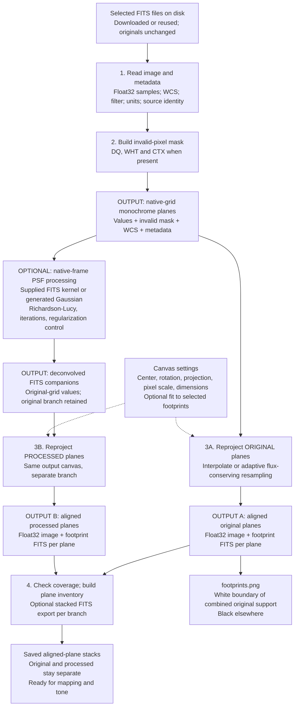
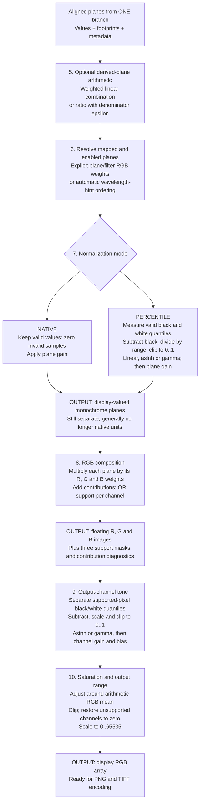
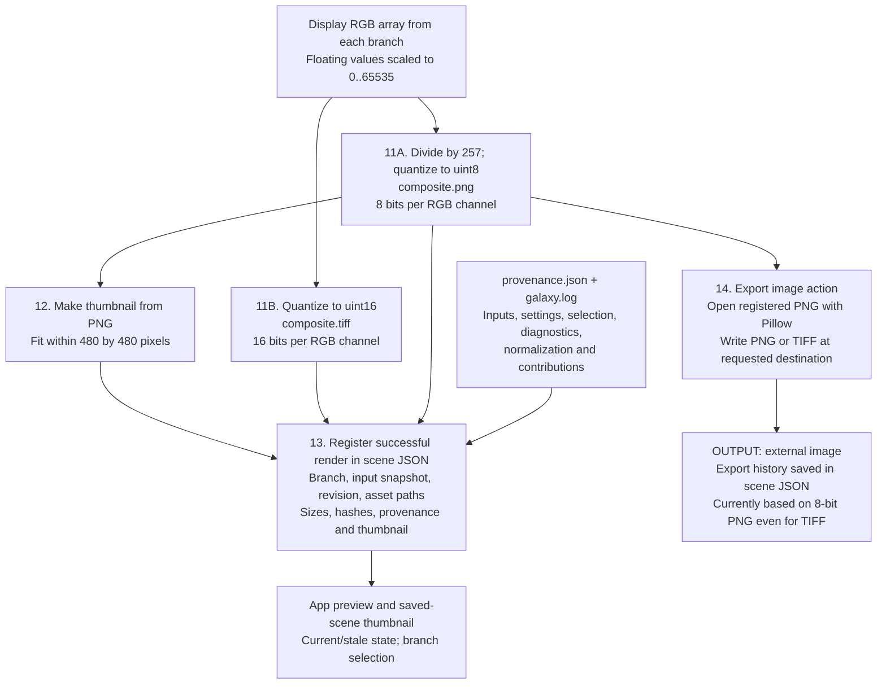

# Galaxy image processing: current implementation

Baseline: 2026-09-27. This describes inspected running code paths, not the proposed algorithm roadmap or a claim that all paths are fully compliant. Original FITS files are preserved. A **plane** is one monochrome image; **WCS** describes where its pixels lie on the sky; a **mask/footprint** identifies where usable measurements exist. Settings come from the saved scene JSON.

## 1. FITS files to aligned monochrome planes

Solid arrows carry image data or saved outputs; dashed arrows supply settings or identify reuse. The optional PSF branch produces a second result; it is not mixed into the original branch.

The two inputs to step 4 are handled as separate sets, not blended together. Normal full rendering processes the original branch and also the deconvolved branch when available.

| Stage | What actually happens | Output and limitations |
| --- | --- | --- |
| FITS read | Select first image-bearing SCI/PRIMARY HDU in file order, otherwise first image HDU; require image WCS. Read metadata with header fallbacks. | Float32 values in native units. No physical unit conversion or background subtraction. One selected image plane per file, not a general spectral-cube decomposition. |
| Mask construction | Mark nonzero DQ, nonfinite/nonpositive WHT, and zero applicable CTX as invalid. Combine matching extensions; higher-dimensional CTX is reduced across context planes. | Separate boolean invalid mask. This does not propagate an ERR/variance map or use WHT as quantitative inverse-variance weighting. |
| Selection/readiness | Apply enabled-filter list and validate plane references. Read failures may be logged/skipped unless fail-fast is enabled. | Usable plane set or explicit failure. Disabled plane IDs are excluded later during composition, rather than necessarily avoiding their reprojection. |
| Canvas preparation | Use configured canvas. Search-region frames can be fitted from selected FITS footprints, with confirmation required for suspicious geometry. UI also provides Fit selected scans and a pending colored geometry preview. | Common sky grid, memory estimate and large-memory warning. Union fitting is not a common-valid-data crop. |
| PSF branch | Load/normalize supplied kernel or make Gaussian; apply RL per enabled policy. Disabled/unprocessed planes can pass through in the companion branch. Save companions. | Separate original-grid FITS. Current mask is attached after RL rather than used inside it; angular Gaussian width lacks native pixel-scale conversion. These are known review concerns. |
| Reprojection | Replace masked native samples with NaN before resampling; resample each branch onto common WCS. Convert output NaNs to zero and retain separate footprint. | Same-sized aligned images; zero does not by itself identify missing data. Float32 data plus footprint are the paired output. |
| Coverage/inventory | Reject original selected planes with zero measured support; build branch plane records and optional stacked FITS exports. | Source/filter/unit/coverage information and reusable stacks. Fractional footprint is used as positive support in composition, not as statistical weight. |
| Footprint raster | OR the original footprints, then draw the combined support boundary. | `footprints.png` is a union outline in current code, not a distinct outline of every contributing source. The pending Fit preview is a separate visualization. |

## 2. Aligned planes to color image

Run this sequence independently for each branch. Intermediate display arrays below are normally held in memory; they are not all saved as separate FITS files.

| Step | Current behavior important for interpreting the image |
| --- | --- |
| Derived arithmetic | Operates on aligned sample values before display normalization. Weighted sums or ratios of weighted sums are supported by configuration. Derived planes do not receive an explicit combined footprint in the present implementation; operand validity is not fully preserved. This is not robust same-filter stacking. |
| Mapping | Explicit mappings select a plane ID or all matching filter names. Otherwise filters are sorted by wavelength hints and assigned evenly spaced hues by rank. The two strategy names currently use the same function; there is no separate wavelength-distance interpolation implementation. |
| Plane normalization | New recommended scenes use 0.5/99.5 percentiles, asinh parameter 4 and gain 1. Older omitted policies resolve to native mode. Overrides can be specified per mapping. Degenerate black/white ranges use a small positive epsilon. |
| RGB composition | Weighted addition, not contributor-count averaging, feathering, background matching or uncertainty-weighted stacking. Missing distinct bands can change color. Records per-plane black/white, support, gains and channel contribution; warns about mixing known native units while native normalization is active. |
| Output tone | A second normalization/stretch after RGB mixing. A shared percentile setting still produces different numeric black/white values for each channel because their distributions differ. Asinh/gamma parameters, gain and bias are per channel. |
| Saturation | Adjusts deviations from the arithmetic mean of RGB, then clips. This is not a separate physical luminance calculation or a color-preserving shared-intensity stretch. |

The distinction between steps 7 and 9 matters for the blue-sky investigation: a percentile black point is not necessarily the local sky pedestal, and the residual can be lifted by both nonlinear stages.

## 3. RGB arrays to files, preview and scene history

Processed filenames use `_deconvolved`, including `composite_deconvolved.png`, `composite_deconvolved.tiff` and its thumbnail. Both branches can be saved by the pipeline; the Output screen's current export call uses the original branch by default even if another branch was previewed.

The native 16-bit TIFF exists in the render directory. The separate UI export action currently re-encodes the registered PNG instead of selecting that TIFF. Therefore a TIFF chosen in the Output screen is not equivalent to the pipeline's 16-bit TIFF. This is a description of current code, not a recommended design.

Changing Output dimensions preserves aspect ratio and adjusts pixel scale to retain sky extent. It changes the canvas and requires a fresh current render; it is not a last-step resize of an existing composite.

## 4. Reuse paths and controls

| Path | Entry/exit |
| --- | --- |
| Full scene render | Save/freeze validated scene settings, use exact selected local/downloaded products, then execute stages 1 through 14 as applicable; final external export is a separate user action. |
| Download-only | Stop after obtaining FITS files and writing manifests/provenance; no image processing. |
| Reproject-only | Stop after aligned branches, stacks/footprint output and provenance; no RGB composition. |
| Compose-only | When aligned stacks exist, load them with their footprints/metadata and resume at composition. Does not recompute PSF or WCS on that path. Without stacks, the lower-level code falls through to cached-FITS processing, so the mode name alone does not guarantee reuse. |
| Direct aligned-FITS preview | A separate UI path loads an aligned stack, assigns automatic mapping, uses native normalization and 1/99-percentile asinh(4) output tone, and displays an 8-bit image. It currently omits the loaded footprints when calling composition/tone. It does not create scene provenance/history or enable scene save by inventing archive metadata. |
| Background worker | Runs scene processing with progress and cancellation at stage boundaries. Successful immutable render history is merged into the latest scene; concurrent edits are preserved and stale results are not presented as current. Failures/cancellation retain previous successful previews. |

The UI directly exposes plane RGB weights, output black/white percentiles and saturation, frame changes, plane inventory and branch preview. Some implemented parameters live in scene JSON/configuration rather than a dedicated interactive editor: derived-plane equations, normalization overrides, per-channel stretch/gain/bias, and PSF kernel policies. Presence in this diagram does not imply a visible slider for every parameter.

## 5. Saved products versus in-memory intermediates

| Product | Saved? | Used next by |
| --- | --- | --- |
| Selected source FITS | Yes, unchanged | FITS loader, footprint fitting |
| Native values + invalid mask + WCS | In memory | PSF branch and reprojection |
| Deconvolved companion FITS | Yes if enabled | Processed-branch reprojection |
| Reprojected image and footprint per plane | Yes | Branch export and composition |
| `exported_planes.fits` / `exported_planes_deconvolved.fits` | When configured | Compose-only, direct aligned preview, external inspection |
| Derived arithmetic planes | In memory during composition | Mapping/normalization |
| Normalized display planes | In memory | RGB mixer |
| RGB values + per-channel support | In memory | Output tone |
| Final tone-adjusted RGB | In memory | PNG/TIFF encoders |
| Composite PNG/TIFF and thumbnails | Yes | Preview, scene library, export |
| Manifests, provenance, logs, scene JSON | Yes | Reproducibility, diagnostics, saved history |

## 6. Where future algorithms would attach — not present today

These attachment points are annotations, not extra boxes in the current pipeline:

- After native loading and before nonlinear normalization: background/pedestal modeling; geometry-qualified detector correction; improved native PSF processing.
- Around/after reprojection: residual registration, same-band combination and explicit common-support/cropping policy. Each requires coordinated mask/WCS handling.
- Before RGB mixing: stable per-band normalization references and qualified wavelength metadata/mapping.
- At RGB mixing: contributor-aware composition and optional edge transitions.
- At output tone: color-preserving main stretch, auto-stretch parameter estimation, GHS and eventually monotonic curves.

`empirical_psf.py` contains an estimator helper with tests, but it is not called by the production scene pipeline or UI. `apply_presentation_psf` is likewise not the active scene branch; the active call is `build_deconvolved_plane_artifacts`. Neither helper should be drawn as an additional current production stage. Background modeling, debanding, GHS, star separation, Gaia calibration and drizzle reconstruction are not current processing stages.

## Evidence and review scope

Source inspection phases completed: trace active entry points; follow values and artifact writes; distinguish optional/reuse/preview routes; cross-check gaps and preserve a human baseline. This is documentation, not an implementation change or new requirements acceptance. No tests were added or run for this diagram; the preceding feature review's test results are not claimed as verification of every path shown here.

Primary anchors: `src/galaxy/fitsio.py`, `psf.py`, `reprojection.py`, `planes.py`, `mapping.py`, `tone.py`, `export.py`, `pipeline.py`, `scene_execution.py`, `scene_pipeline.py`, `scene_workflow.py`, `ui.py`, and `processing_config.py`. Known concerns remain tracked in `docs/compliance_status/known_gaps.md`; this baseline additionally records the direct-stack footprint omission, derived-plane footprint omission, and PNG-based external TIFF export as observed limitations rather than silently assuming intended behavior.
