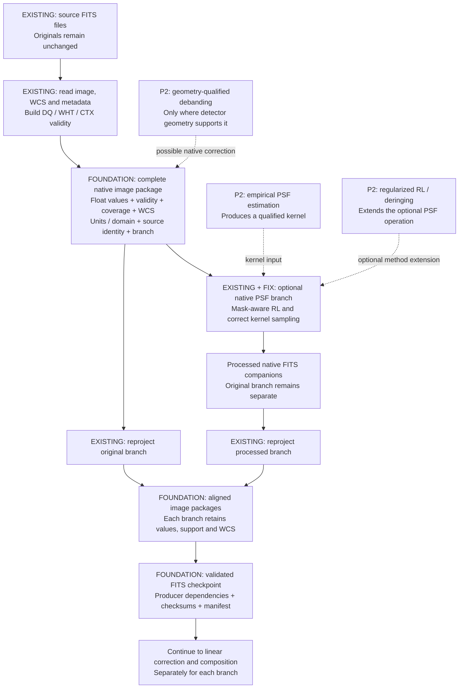
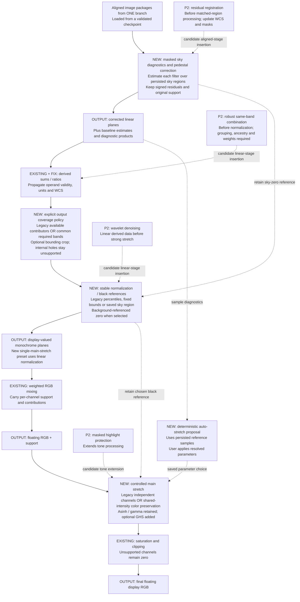
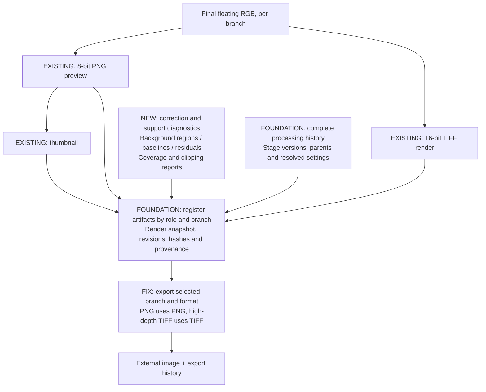

# Proposed

Galaxy image-processing architecture, 2026-09-28. Companion to [the implementation plan](image_processing_upgrade_implementation_plan.md); compare with [the current architecture](current_image_processing_architecture.md).

**EXISTING** means a current operation retained. **FOUNDATION/FIX** means P00 or essential P0 changes. **NEW** means a planned feature in Phases 3-5. **P2** means a candidate insertion point only, pending user selection. Solid arrows carry data; dashed arrows supply parameters or indicate potential additions. This is not a claim that the new behavior is implemented.

## 1. Native FITS to reusable aligned data

The convergence at aligned packages means a common interface, not mixing of the original and processed branches. Kernel generation feeds PSF processing; it is not another RGB-processing step. Debanding on an already resampled archive mosaic needs its own geometry-qualified specification; merely loading that mosaic does not restore detector coordinates.

## 2. Linear corrections, coverage, normalization and tone

Background correction has an **off** mode. It runs after current native PSF/reprojection in the initial plan; it does not silently feed signed residuals into RL. The coverage policy controls presentation support without rewriting observational validity.

The black-reference links are essential: subtracting a constant pedestal and then recomputing independent percentiles over the same samples can cancel the subtraction's visual effect. The chosen sky reference must survive both normalization and output tone.

P2 placement arrows identify relevant boundaries, not a fixed ordering among all candidates. If same-band stacking is selected, its subplan must decide background matching before combination, residual registration order, uncertainty propagation and independent-source grouping. Noise-based weights belong to comparable same-band measurements and are not a new default for mixing unrelated filters.

Shared-intensity stretching preserves RGB ratios before gamut/clipping handling. It does not fix an already biased background. Legacy recipes retain their existing normalization/stretch behavior; the single-main-stretch preset is an explicit alternative.

## 3. Output, provenance and reuse

Across all stages: numerical functions preserve input ownership; image packages retain support and geometry; scene settings participate in current/stale detection; stage diagnostics are distinguishable from observations; failures/cancellation preserve earlier successful renders. Scene rendering and direct aligned-FITS preview share one numerical core.

Reuse rules:

- Tone or post-alignment pedestal changes reuse the unchanged pre-correction aligned checkpoint and recompute downstream results.
- Canvas, source validity, native kernel or native-correction changes invalidate the affected aligned branch.
- Compatibility keys establish whether reuse is appropriate; file checksums establish integrity. Both are required.

## Scope boundaries

Phases 0-2 establish infrastructure and correctness; Phase 3 adds pedestal diagnostics/correction with a functioning black-reference policy; Phase 4 expands coverage/reference policies; Phase 5 adds shared-intensity tone, auto-stretch proposals and GHS; Phase 6 closes out verification. P2 boxes remain unselected until the user chooses them.

Polynomial backgrounds, feathered full-union composites, arbitrary cross-filter histogram matching, LRGB, spline curves, star inpainting, Gaia calibration and drizzle are not implied by this diagram. They remain outside the bounded implementation plan unless separately selected/scoped.
